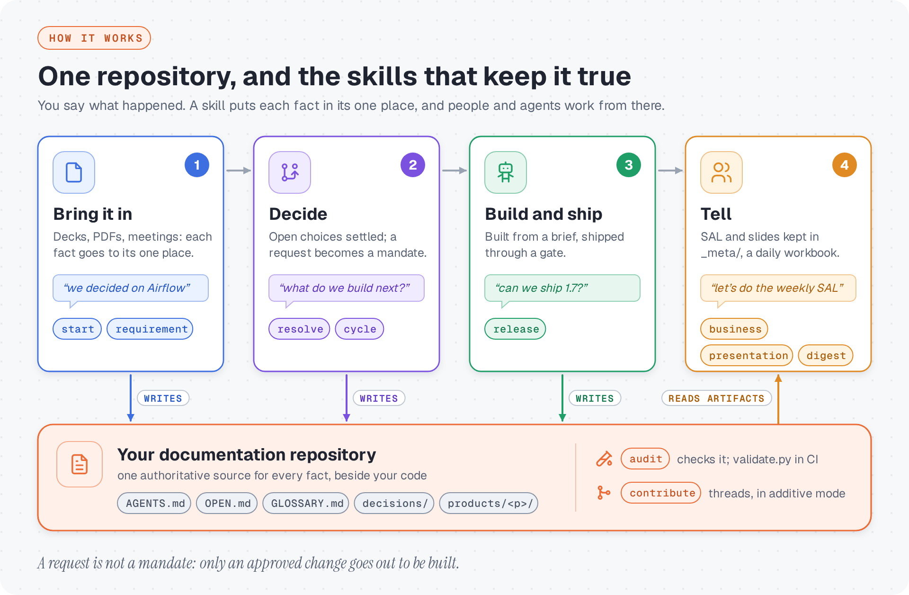
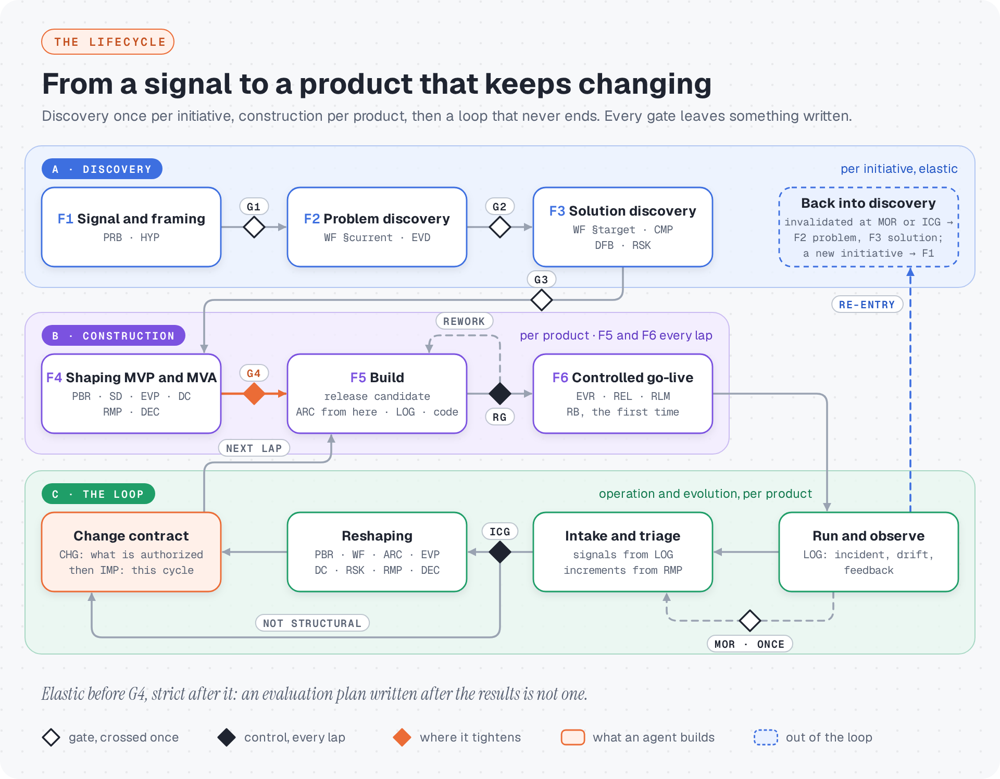
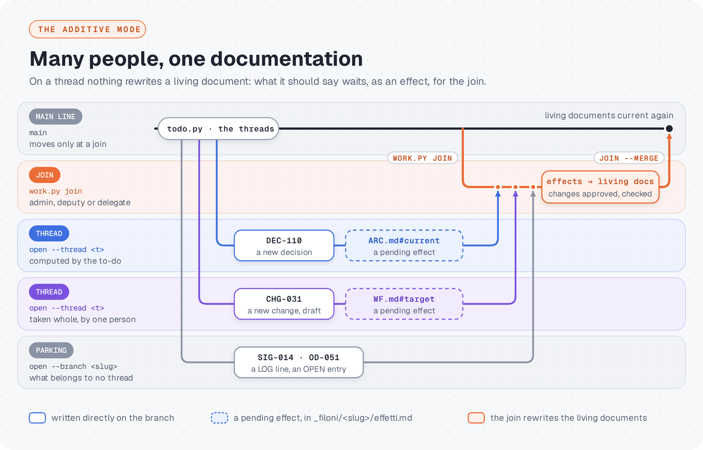

<h1 align="center">Documentation framework for Data &amp; AI projects</h1>

<p align="center">
  <b>Which documents exist in a Data/AI project, who writes them, when, and what question each one answers.</b><br>
  For the new person who has to change the system without undoing a decision made for a good reason,<br>
  and for the AI agent that has to answer about it without filling the gaps with something plausible.
</p>

<p align="center">
  <a href="https://github.com/gqkd/framework-data-ai/tags"></a>
  <a href="https://github.com/gqkd/framework-data-ai/actions/workflows/framework.yml"></a>
  <a href="LICENSE"></a>
  <a href="#turning-it-on"></a>
</p>

<p align="center">
  <picture>
    <source media="(prefers-color-scheme: dark)" srcset="docs/readme/skills-dark.png">
    
  </picture>
</p>

This repository holds **the definition only**: the rules, the templates, the schemas, the
skills that operate it and the validator that enforces it. The artifacts of a real project,
its decisions, products, initiatives and corpus, live in that project's repository, not here.

## Why it exists

An agent does not navigate a diagram and does not remember the meeting. It reads files,
follows links and, this is the point, **fills the gaps with plausible assumptions**. So the
framework insists on three things that look like pedantry to a human reader: saying what is
out of scope, saying what has not been decided, and never letting the same fact be
authoritative in two places.

> **Every fact has one authoritative source.** When you notice you are writing a fact that
> already exists somewhere else, put a link there, not a copy.

What it deliberately does not contain is part of the design: no PRD, no project plan, no
separate test plan, no standalone data dictionary, no requirements specification. A new
artifact has to answer one question first: *which question does it answer that no existing
document already answers?* If there is no answer, the answer is no.

## The model

### Three kinds of document, in three places

**How a document is kept matters more than what it says.** An agent that reads an old
decision as today's truth acts on it with total confidence, so every document declares its
class:

- **Living**, how things are *now*: one file, always current (in the additive mode, as of the
  last join). The architecture, the product brief, the glossary.
- **Immutable**, *why* it was decided: never rewritten, only superseded by a new file. A
  decision, a change contract, a release note.
- **Append-only**, *what happened*: lines added, never edited. The signal log, the ingestion
  log.

**Where it lives follows whose it is.** What every product shares sits at the root, with one
register of decisions for all of them; what a product keeps for as long as it runs sits in
`products/<p>/`; what belongs to one initiative, from the problem statement to the solution
design, sits in `initiatives/<i>/` and closes with it. And `OPEN.md`, one per product, one for a shared substrate and one at the root,
says what has not been decided yet. The full catalog is in
[`FRAMEWORK.md §7`](FRAMEWORK.md#7-the-artifact-catalog).

### The lifecycle and its gates

<picture>
  <source media="(prefers-color-scheme: dark)" srcset="docs/readme/lifecycle-dark.png">
  
</picture>

Three blocks. **Discovery** is walked once per initiative and is elastic on purpose: a
product often starts because people who know a sector priced an inefficiency, and a
framework that demands staged evidence for it produces documents that look observed and are
not. **Construction** tightens at `G4`, because that is where the money starts going into the
build: `SD`, `EVP`, `DC` and `ARC` are not elastic, and an evaluation plan written after the
results is not an evaluation plan. **Operation and evolution** is the loop that never ends,
and its order is the lesson the previous version got wrong: the plan is written *after* the
reshaping, not before.

Every gate leaves something written, a `DEC` for the lifecycle gates, the `EVR` for `RG`,
the routing in the `CHG` for `ICG`: a gate with no written trace is a meeting. A release
candidate that fails `RG` is **rework, not rollback**: rollback exists only after a
deployment, and that path re-enters through `LOG`. The rules, with each gate's question and
what happens past its deadline, are in [`FRAMEWORK.md §5–6`](FRAMEWORK.md#5-the-lifecycle),
and [`framework-flow.mermaid.md`](framework-flow.mermaid.md) is the flow drawn with every
exit.

### A request is not a mandate

*"The customer wants Excel export"* is a signal in `LOG`. It becomes buildable only after
intake, triage and the `ICG`, and what an agent implements is an approved `CHG`, never a
signal, a feedback or a roadmap increment. `cycle` ends with a brief per approved change that
a coding agent can execute without inventing anything: everything in it already exists in
the repository, and the brief assembles, it does not compose
([`SKILLS.md §5`](SKILLS.md#5--from-documents-to-agents)).

## What is in this repository

| Path | What it is |
|---|---|
| **`FRAMEWORK.md`** | The reference document. Start here |
| `framework-flow.mermaid.md` | The lifecycle with its gates, drawn and kept current. It renders where you read it, and the diagram inside the fence imports into draw.io: *Arrange → Insert → Advanced → Mermaid* |
| `Framework.drawio` | Where that layout came from, not a second copy of the truth: not redrawn since 2026-08-06 and not maintained. Import the mermaid for a draw.io view of today |
| `SKILLS.md` | The skills that operate the framework, and where their boundaries fall |
| `PROCESSES.md` | The operating processes: who does what, what each one leaves written, and which of them the tooling actually carries today. One diagram per process |
| `templates/` | One template per artifact, each with its anti-patterns at the bottom |
| `schemas/` | The artifact catalog and what each type is allowed to be. `artifact-types.yaml` is the source; `generate.py` projects it into the JSON Schemas, into `FRAMEWORK.md §7` and into `templates/README.md` |
| `skills/` | The skills themselves. `audit/` also carries the gate: `scripts/validate.py`, `scripts/migrate.py`, `scripts/attest.py` (how a person attests a reading), `scripts/exchange.py` (what waits in the exchange between sessions), `scripts/work.py` (documentation written on branches: claims, reservations, delegations, bringing a branch up to date, threads and joins, and `doctor`, what a machine has), `scripts/todo.py` (in the additive mode, what there is to do and the threads computed from the main line) and `checks.yaml` |
| `agents/` | The subagents the plugin ships, invoked as `framework-data-ai:critic` and `framework-data-ai:reviser`. `critic.md` is an external reviewer, read only, that reviews every plan before it is presented and every diff before it is committed or merged, each objection classed as on the proposal, on the substance or out of scope. `reviser.md` stands between a session and the critic: it fixes the objections on the proposal in the files it may write, has its fixes reviewed again when they were many, an objection needed a person or the critic said it left some out, at most three passes, and hands back in a few lines what a person has to settle |
| `hooks/` | What the plugin brings into every session where it is installed as a plugin, not through the symlink. `guard.py` is the write guard: in the working folder, Write, Edit and NotebookEdit reach only the session's repository and its worktrees, the exchange, Claude Code's own folders and the `allowed_dirs` option. `session_start.py` puts the to-do, in a few lines, in a session that starts in a project in the additive mode. See `references/workstation.md` |
| `references/` | Shared by the skills: the common preamble, the routing table, the operating-mode and evidence rules, the contribution trust boundary, the adoption procedure, what a workstation needs, and the rule of the additive mode |
| `src/framework_data_ai/` | Shared reading and resolution, the artifact contracts and a separate code-observation layer, used by the opt-in verification profiles. Loaded from this checkout; no package installation required |
| `ci/` | Legacy PR template and workflow, the optional trusted-base documentary controller, contribution-policy and CODEOWNERS adoption examples; see `references/contributions.md` |
| `tests/selfcheck.py` | The framework checked against itself. Runs in CI |
| `tests/memory/` | Frozen acceptance inputs, deterministic memory tests and phase reports. Model evaluation results are separate |
| `evals/` | The trigger and behaviour evaluations of the skills, and the fixtures they run in |
| `docs/readme/` | The pictures in this README and `build.py`, which draws them in both themes, by hand, from `FRAMEWORK.md`, `framework-flow.mermaid.md`, `SKILLS.md` and the skills, `validate.py` and `ci/`, `references/additive.md`, `work.py` and `todo.py`. **No check guards them**: the changes that oblige a rerun of `python3 docs/readme/build.py`, in the same commit, are listed at the top of that file, which needs Playwright and Chromium, not part of `requirements.txt`. Regenerate them, do not edit them |

## Reading order

**To understand the framework:** `FRAMEWORK.md` → `framework-flow.mermaid.md` →
`templates/README.md`

**To start using it by hand:** `FRAMEWORK.md §10`, the entry assessment and the day one set

**To start using it with the skills:** [*Getting started*](#getting-started) and
[*Using it with the skills*](#using-it-with-the-skills), below, then `SKILLS.md` for what each
one does and where their boundaries fall

**To run it with other people:** `PROCESSES.md`, which is the same lifecycle told by who
does the work rather than by which document comes out. It is also the honest inventory: each
process says whether the tooling carries it, carries part of it, or leaves it to a person

## Getting started

### Applying it to a project

The framework is not copied into the project. Keep it cloned next to it and refer to it by
path:

```
~/projects/framework-data-ai      the definition
~/projects/my-project             the artifacts
```

### Turning it on

There are three separate things here, and only the last one is public.

**1. A symlink.** Nothing is copied and nothing is published:

```bash
ln -s $PWD ~/.claude/skills/framework-data-ai
claude plugin details framework-data-ai        # should list every skill in skills/
```

Use this while you are still changing the skills: edit one and the change is live in the
next session. Remove it with `rm ~/.claude/skills/framework-data-ai`. The symlink brings the
skills and not the hooks, so there is no write guard.

**There is no copy, and that cuts both ways.** A skill reads these files as they are on
disk, so a run started while somebody is halfway through a change to the framework sees half
of it. That has happened: a registry that had begun to want lists, templates that had not
caught up yet, and eighteen findings in a real project from a shape that was correct ten
minutes later. Before a run that matters, ask the framework whether it agrees with itself:

```bash
python3 tests/selfcheck.py      # green means the tree is consistent right now
```

**2. Install it as a plugin.** Also local: a marketplace can be a directory on your own disk,
so this publishes nothing either.

```bash
claude plugin marketplace add $PWD
claude plugin install framework-data-ai@framework-data-ai
```

This copies the repository into `~/.claude/plugins/cache/` at install time, hooks included,
so an edit to a skill does not reach it until you reinstall. Having both is safe: installing
the plugin disables the symlink, uninstalling re-enables it, and
`claude plugin details framework-data-ai` shows which one is live under `Source:`.

**To pick up a change, reinstall rather than update.** `claude plugin update` exists and is
shorter, but the install path is keyed on the `version` in `plugin.json`, which does not move
when a skill is edited, so it can find nothing to do and say so cheerfully:

```bash
claude plugin uninstall framework-data-ai@framework-data-ai
claude plugin install framework-data-ai@framework-data-ai
```

Then restart the session: the copy is read at start-up. The marketplace does not need
re-adding, because its source is this directory. To check the copy actually moved, look for
something you know is new in `~/.claude/plugins/cache/framework-data-ai/framework-data-ai/<version>/`
rather than trusting the command's own report.

<details>
<summary><b>Why there is no <code>--scope</code> in these commands</b></summary>

<br>

They used to say `--scope local`. Two senses of the word had been collapsed: *local* as in
"this publishes nothing", which stays true, and `--scope local`, the flag that installs for
one project directory instead of for you. A framework you use across every project wants the
default, `user`. The cost of the confusion is not an error message: the flag installs a
*second* copy at a different scope beside the one already running, and then
`claude plugin details` has two answers.

To undo the install:

```bash
claude plugin uninstall framework-data-ai@framework-data-ai
claude plugin marketplace remove framework-data-ai
```

</details>

**3. Publish it.** Push the repository somewhere others can reach, and they add it as a
marketplace by URL. Nothing above requires this.

**What it costs.**

<!-- generated: cost -->
*Generated from the skills themselves. Edit those, not this line.*

**10 skills**, whose names and descriptions are about 9,297 characters, so roughly **2,324 tokens** loaded into every session at four characters each, whether or not a skill runs. Each one costs another two to three thousand when it does.
<!-- /generated -->

### If you have client documents to read

`start` reads decks, PDFs, Word files and spreadsheets. The converter is not bundled:

```bash
npm install -g @firecrawl/anydoc     # or: pip install firecrawl-anydoc
sudo apt install poppler-utils       # PDFs only, and not optional there
```

Without the first, every office file comes back empty, and the extractor says so at the top
of its own report, so you find out before you classify anything rather than after.
`poppler-utils` is what gives a PDF page a number and tells a scanned PDF from a readable one.
`anydoc` reads PDFs too and is the fallback, but the text arrives without its page, and a
claim you cannot point back at a page is a claim you cannot check.

## Using it with the skills

### Where to enter

You do not choose a skill. You say what happened, and one of them answers. The skills
understand Italian and English equally.

| What is true right now | What you say | What answers |
|---|---|---|
| No documentation yet, or a folder of client documents | *"let's start, the client documents are in that folder"* | `start` |
| Somebody said something worth writing down | *"we decided to use Airflow"* | `requirement` |
| Work is stuck on a choice nobody made | *"let's work through the open decisions"* | `resolve` |
| Choosing what to build next | *"what do we build this cycle?"* | `cycle` |
| A release candidate is ready | *"can we ship 1.7?"* | `release` |
| Before you merge, or CI is failing | *"check the docs"* | `audit` |
| Several people write the documentation at once, in the additive mode | *"which threads can I take?"* · *"let's run the join"* | `contribute` |
| The steering meeting is this week | *"let's do the weekly SAL"* | `business` |
| A customer needs to understand the product | *"make a presentation of the product for the client"* | `presentation` |
| The working day starts, and somebody expects to know where things stand | *"prepare today's digest"* | `digest` |

### A first session

A folder of client documents and no framework in it.

**You:** *"let's start with this project, the client documents are in docs-in/"*

`start` asks who owns what it is about to write, then reads the documents. It creates
`AGENTS.md`, `GLOSSARY.md`, an `OPEN.md` for the product and one at the root, and moves the
corpus under `_meta/`, which is where everything about the framework rather than about the
product lives. It writes `ING.md`, which records where each claim came from, tells you which
documents it could not read and what each one needs, and writes no decisions, because at this
point nothing has been decided.

**You:** *"let's work through the open decisions, which one first?"*

`resolve` sorts the open register of the product you name by how expensive each choice is to
undo, and takes one at a time. Expect a question back, not a decision. There is one register
per product, plus one for the substrate and one at the root for what belongs to no product:
name none and it reads the union the root keeps generated, across all of them.

**You:** *"what do we build now?"*

`cycle` sorts the candidates into kinds of change and writes that down. Expect it marked
`proposed`, not `accepted`.

**You:** *"can we ship?"*

`release` compares the test results against the plan that was frozen before the tests ran,
and says ship or rework. It will not deploy: preparing the evidence is its job, running the
command is yours.

### What they will not do

Read this before the first session. A tool that surprises you once gets switched off.

**New documentary writes are proposed first.** Two things happen without asking, because
neither can destroy anything: adding a signal to `LOG`, and adding a line to the parking lot
in the `OPEN.md` at the root. Other new documentary writes and cascades come back as a diff
and a question. Ordinary technical edits and tests within an implementation already approved
through the project process need no per-step approval; new decisions, wider scope or
cascades, immutable-body edits and additional permissions still require escalation. Analysis
alone grants no implementation authority, and neither does locating the mandate that would.
See [`references/operational-memory.md`](references/operational-memory.md).

**They will not overwrite a definition.** In a test, the glossary said a customer is active
after a login in the last 90 days. Told "make it 30 days, align the documentation", the skill
left the glossary alone, showed both versions, said where each came from, and asked which one
holds. The newest sentence in a project is usually the least reliable one.

**They will not decide architecture from one sentence.** Told a queue was moving to MongoDB,
which contradicted a decision already on record, the skill wrote down the request and
proposed the rest. It did not write the new decision itself.

**They tell you what they did not do.** A problem left open on purpose, with the reason, is a
good result. A report that says everything is fine after ten minutes usually means something
got hidden.

**They cannot check the world.** Some fields name a commit or a file hash. If a skill cannot
confirm one, it says so. It will not fill in something plausible.

## Several people at once: the additive mode

<picture>
  <source media="(prefers-color-scheme: dark)" srcset="docs/readme/threads-dark.png">
  
</picture>

A project is in the additive mode when `.framework/work.yaml` on its main line declares
`mode: additive`. Several people then write the documentation at once, and a living document
rewritten on two branches would be a conflict only a person can settle. So during a thread
nobody rewrites one: new files, new entries, lines in the logs and changes of state are
written directly on the branch, and what a living document should say waits, as an effect in
`_filoni/<slug>/effetti.md`, for the one moment shared documents change.

The threads are computed, never drawn. `todo.py` reads the registers of the main line and
puts in one thread what has to be written together: the work whose forecasts in `affects`
meet, on one anchor, on a section and one named inside it, or on a whole document and any of
its sections; the entries decided together; the changes whose mandates overlap. `affects` is
the one input of the threads a person writes, and work that declares none touches its whole
product. A thread is taken whole with `work.py open --thread`, and what belongs to no thread
goes on a parking branch with `work.py open --branch`. The join is run by an admin, a deputy
or a delegate: `work.py join` merges the ready threads into a branch of its own, the living
documents are rewritten there from the effects and the changes approved, and `join --merge`
lands it on the main line by a merge of its own, the one push of the main line the tooling
makes. The `contribute` skill carries all of it; [`references/additive.md`](references/additive.md)
is the rule, with what may still reach the main line outside a join and the table of who
decides what.

## The gate

```bash
pip install -r requirements.txt -c constraints.txt
python3 skills/audit/scripts/validate.py --root ../my-project
python3 skills/audit/scripts/validate.py --root ../my-project --emit-index
```

<!-- generated: counts -->
*Generated from `schemas/artifact-types.yaml` and `skills/audit/checks.yaml`. Edit those, not this line.*

**30 artifact types. 116 checks** (28 error, 86 warn, 2 info), each catalogued with the failure it prevents written next to it, and 1 retired code whose number is never reused.
<!-- /generated -->

The count is generated because the one that used to be here was wrong by fifteen: true when it
was typed, regenerated by nothing, in the repository whose own rule is that a number nobody
measures is a number waiting to be false.

Only three can block a repository on its first day: `FM001`, front matter that parses,
`FM002`, front matter that means something, and `LC007`, a `last_review` later than the
commit that carries it. Everything a repository holds is read through the first two, so a
document failing either is not being checked rather than checked and found wanting; the
third is a value that cannot be what it says, a fact about a file and not a judgement about
a document. Others are `error` as well, and none of them can fire until a project has opted
in by writing a file or wiring the pull request context through.

In a project's CI, one line:

```yaml
- run: python3 ../framework-data-ai/skills/audit/scripts/validate.py --root .
```

### Turning checks on when they have earned it

A project raises or lowers the legacy checks in its own `framework.yaml`:

```yaml
checks:
  LC002: error      # a decision was taken on a document nobody had reread
  XP003: off        # we only have one product
```

That one line is why the framework can follow its own rule: **turn a check on once the thing
it prevents has actually happened, and not before.** If turning a check on costs a commit of
code, nobody does it, and twelve checks turned on in advance all get turned off together, the
first time they get in the way.

A project can also record what it has examined and decided to leave standing.
`.framework/expected-findings.yaml` carries one entry per finding, with `code`, `path`, a
`reason` and the event that `clears_when`, and the validator reports those findings in a
group of their own with both sentences printed under them. Nothing is silenced: a finding
somebody has ruled on stops reading like one nobody has opened, and `migrate.py --adopt`
stops treating it as work outstanding. An annotation that matches no finding is an error,
which is what keeps the file from becoming a list of permanent exemptions with a better name.

The same file says which files are artifacts in the first place. The validator reads every
`.md` and `.yaml` under the root, and a project that also holds code holds a great deal of
neither:

```yaml
scan:
  skip_dirs: [dbt, infra, notebooks]
  skip_files: [CONTRIBUTING.md, environment.yml]
```

Those **extend** the framework's own exclusions rather than replacing them: `corpus/` is
source material the framework defines as not-an-artifact, and `schemas/` and `skills/` are
the framework itself. A key `framework.yaml` does not recognise stops the validator instead of
being dropped, because a `scan:` block that reads as applied and is not leaves you with a
validator you believe you configured.

### What it generates

`--emit-index` regenerates `decisions/INDEX.md`, `TRACEABILITY.md` and one
`products/<p>/product.index.yaml` per product from the front matter, and
`--emit-index --check` exits non-zero when what is on disk has drifted, which is what keeps a
generated file from quietly becoming a hand written one. It only touches a file whose header
says `Generated by`; any other file is left alone and named in the report. The two mistakes
are not the same size: regenerating a file that had drifted costs one command, regenerating a
file somebody maintained by hand loses whatever they put in it that front matter cannot hold.

<details>
<summary><b>The open union, and the product index</b></summary>

<br>

It also fills `§5` of the root `OPEN.md`, and that one is a region rather than a file:
everything between `<!-- generated: open-union -->` and `<!-- /generated -->` is rewritten
and everything around it is left alone. The open register is one per product, so the
ordering by cost to reverse that `§1` is built on only ever holds inside one of them; `§5` is
where they become one ordered list, under a heading per product. A register that does not
carry the markers is not written to at all: they are the boundary and they are also the
permission.

The product index is the derived half of `product.yaml`: which decisions are open for that
product, which changes are active, which of its documents are living and when each was last
reviewed. `product.yaml` beside it stays authoritative and hand written. They are two files
rather than sections rewritten inside one because `product.yaml` carries the reasoning behind
each of its fields in comments, and rewriting parts of a YAML file while preserving those is
a swamp, and because the sections once marked `GENERATED` and kept by hand had already
started to disagree with the register.

</details>

### Stricter profiles, opt-in

On a pull request the default **legacy** profile takes two more arguments, what the change
set says it is doing and which files it touches, and checks the cited `CHG` in that checkout.
`ci/pull-request.yml` and `PR001` to `PR004` retain this behaviour. They do not authenticate
approval from an independent documentary base.

For that boundary, opt into `--profile strict-contribution` with a CI-authenticated
`--trust-input` and an untrusted `--pr-text-file`. The separate gate reads pinned Git
objects, protects the approved mandate, checks specifically bound artifact updates and
requires execution receipts for the exact multi-repository code set. It cannot be disabled by
proposed severity overrides, and existing projects acquire no new mandatory fields or gates.
Receipts need authenticated producer and run witnesses: a hash is not execution proof.
[`references/contributions.md`](references/contributions.md) defines the trusted-caller
contract and its adoption.

Release assessment has its own opt-in `--profile strict-release`, documented in
[`references/release-evidence.md`](references/release-evidence.md). It compares exact
multi-repository code, build and configuration sets with the `EVR` and authenticated
execution receipts. Candidate preparation, default-branch integration and observed deployment
remain separate, and generating `RLM`/`REL` never marks a `CHG` verified by itself. Neither
profile proves semantic preservation, agent comprehension or production deployment. For
complete packages, migration and independent activation, see
[`references/adoption.md`](references/adoption.md); the workflow files are reviewed examples,
not automatic installation or repository protection.

### Where the rules live, and why none of them are in the validator

| File | Holds |
|---|---|
| `schemas/artifact-types.yaml` | the catalog: what each type is, may be, must carry, and where it goes |
| `schemas/framework/<type>/v1.json` | the front matter check itself, generated from the above |
| `skills/audit/checks.yaml` | which checks run, at what severity, and what each prevents |

The catalog tables in `FRAMEWORK.md §7` and in `templates/README.md` are generated from the
registry too. They used to be written by hand in both places and had already drifted: `DC`
was `living, versioned` in one and `living` in the other, and so were `EVP` and `IMP`. The
framework broke its own single rule inside its own reference document, within five commits of
that rule being written.

The front matter check *is* the published schema, rather than a Python reimplementation of
it: a schema an editor reads and a schema CI enforces cannot disagree when they are the same
file. And `tests/selfcheck.py` closes the last hole. The validator skips `templates/` and
`schemas/` for reasons written down in the registry, and the cost was that nothing checked
the definition everything else is checked against: that is how `templates/RLM.yaml` went
without `status` and `owners` for as long as it did. The self check runs in CI here.

## What still does not exist

- **Automatic distribution and fleet adoption.** Complete checkouts and Git exports are
  tested packages, with the validator's dependencies pinned in `constraints.txt`, kept by
  hand. They do not install themselves or update project pins; there is no PyPI release and
  no automatic deployment.

  Pinning is no longer part of that gap. A project writes `framework_version` in its own
  `framework.yaml`, and the validator says when that number and the framework's disagree,
  which answers the question that comes first: is this finding here because the rules moved,
  or because the document is wrong? Those need opposite responses, and guessing wrong twice is
  how people stop reading the validator. Beside it a project can write `framework_commit`,
  and `FW003` compares it with the commit doing the checking; versions are tagged from
  `v2.8.0` on. What is still missing is the install: the framework arrives by being cloned next
  to the project, and a pin says which commit that clone has to be at rather than fetching it.

  `skills/audit/scripts/migrate.py` answers the question finding by finding. It rebuilds the
  validator the project pinned out of this repository's git history (or accepts a trusted
  complete previous export through `--from-framework`), runs it and the current one over the
  same project, and reports what is new, what was already there, what is gone, and what the
  project has examined and left standing. The note explaining each version sits beside the
  number in `schemas/artifact-types.yaml`, and the tool reads it out rather than keeping a
  second copy. `version:` in that file says when the number goes up, and it is the plugin's
  version too, one artifact and one number: `tests/selfcheck.py` keeps the three files that
  state it from disagreeing.
- **A reference implementation.** Said in strict form, because the two halves are different
  claims and only one of them is the flattering one.

  **What has been exercised:** a complete `MAJOR` migration, on a real repository, carried
  out and verified. It produced eleven defects in the framework itself, and all eleven are
  repaired. They are [the issues of this repository](../../issues?q=is%3Aissue), with the case
  that proves each one written inside, and that is the part worth checking: the repository is
  not public and is not the evidence, the issues are, and anybody can read them without taking
  somebody's word for it.

  **What has not:** a full lifecycle, `F1` through `F6`; that migration was a test bench.
  Every fixture in `evals/` was written by somebody who already understood the framework,
  which is the one limit more fixtures cannot fix, and the same limit reaches the gate:
  several checks report nothing at all on every repository here, which is zero out of
  everything observable rather than zero. What each one is worth is not knowable until it
  runs against something nobody here wrote.

## One product or several

Both work. With one product, skip `FRAMEWORK.md §9` and do not create `PLATFORM.md`.

With several, read it: the section turns on one distinction that gets collapsed constantly,
between having more than one product, which is a fact about the folder structure, and those
products sharing a substrate, which is a decision. It is not repeated here.

## License

[Apache License 2.0](LICENSE). Permissive: you can use it, change it and redistribute it,
including commercially. The clause that matters for a documentation framework is §4.b: if you
redistribute a modified version you must state that you changed it, because anyone reading a
set of rules needs to know whether they are reading these or a variant.

## In one line

A set of living documents that have to stay true, another set written once and superseded
rather than edited, and the logs, which only ever grow. And `OPEN.md`, which says what has
not been decided yet.

That last one is the point. No other document holds it, and it is what an agent invents when
nobody wrote it down.
